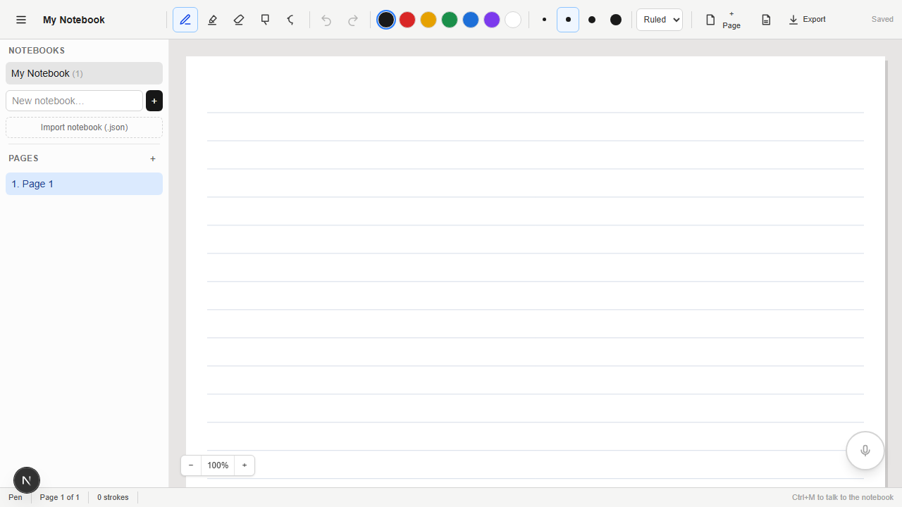
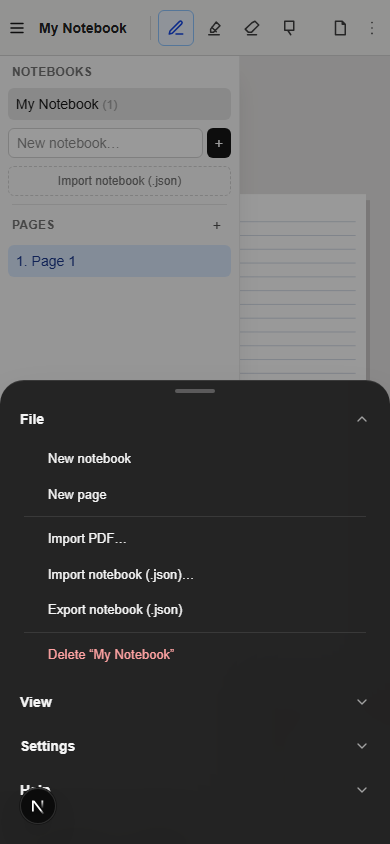

# Margin AI — AI-Ready Digital Notebook

Margin AI is a local-first, Xournal++-inspired handwriting notebook for mouse, touch,
and stylus input. Notes autosave to the browser, while the document model keeps
AI-authored content in a separate, non-destructive layer.

## Screenshots

### Desktop workspace



### Responsive layout

The notebook remains usable on narrow screens with a collapsible, scrollable sidebar.



## Project overview

- **Project name:** Margin AI
- **Short description:** Write handwritten notes with mouse, touch, or stylus across
  multiple notebooks and pages — then ask a voice math tutor to check, finish, hint at,
  or graph what you wrote. Everything autosaves to the browser (IndexedDB) and survives
  refresh. AI-generated content is stored separately from user ink.
- **Team:** TODO — participant names and GitHub handles; maximum 4 members.
- **Working demo:** Local — `npm install && npm run dev`, open http://localhost:3000.
- **Technology stack:** Next.js 16 (App Router), React 19, TypeScript (strict),
  Tailwind CSS 4, HTML Canvas, Pointer Events, IndexedDB (`idb`), `zod`, Vitest,
  Playwright, KaTeX, mathjs, pdfjs-dist.

### Run the project

1. Prerequisites: Node.js ≥ 20 (developed on v25), npm ≥ 10.
2. `npm install`
3. Environment (only needed for the assistant): copy `.env.example` to `.env.local` and set
   `LLM_API_KEY`. Optional: `LLM_BASE_URL` (any OpenAI-compatible endpoint, default
   `https://api.openai.com/v1`; Gemini's documented OpenAI-compatible URL works too),
   `LLM_MODEL` (default `gpt-4o-mini`), `LLM_FAST_MODEL`/`LLM_VISION_MODEL`/
   `LLM_REASONING_MODEL` (per-capability routing, all fall back to `LLM_MODEL`;
   vision requests need `LLM_VISION_MODEL` or an image-capable default), `LLM_TIMEOUT_MS`.
   The notebook works fully without these; the voice assistant then reports that it is
   not configured. For development without a key set `LLM_MOCK=true` (dev/test only —
   refused in production) to get deterministic answers from a mock provider.
4. `npm run dev` → http://localhost:3000 (or `npm run build && npm start`)
5. Checks: `npm test` (Vitest), `npm run typecheck`, `npm run lint`,
   `npm run test:e2e`, `npm run test:e2e:mock` (see Testing).

### Current status

- **Working features:** pen, highlighter, eraser, rectangular selection, and lasso
  tools with pressure-aware strokes; notebook-wide undo/redo; notebook and page
  management (create, rename, reorder, and delete with confirmation); blank, ruled,
  and grid paper; debounced autosave with save status; JSON export/import with schema
  validation and v1→v3 migration; PDF page import as locked page backgrounds;
  multi-tab conflict warning; responsive collapsible sidebar; zoom controls; and
  keyboard shortcuts (`P`/`H`/`E`/`S`/`L`, `Ctrl+Z`/`Ctrl+Y`, `Delete`, `Esc`,
  `Ctrl+M` for voice).
- **App menu:** a File/View/Settings/Help menubar on desktop and a bottom sheet on
  mobile (same item tree, glass style). File handles notebooks, PDF/JSON import and
  export; View handles sidebar, paper style, zoom, and AI-layer controls; Settings
  shows the voice toggle and storage status; Help lists every shortcut and voice
  command.
- **Voice tutor:** the microphone orb (or `Ctrl+M`) starts hands-free dictation.
  Recognized commands include *"check my work"*, *"finish this"*, *"hint"*,
  *"graph this"*, *"read my handwriting"*, *"explain this"*, *"undo"* and
  *"new page"* — anything else becomes a question about the selection (or page).
  Answers are written onto the page's AI layer beside the selected ink, in a pen
  stroke style learned from your own handwriting, and read aloud. Check mode places
  a tick/cross mark beside each handwriting line; graphs are plotted from real
  mathjs sampling; and where a deterministic check ran, the answer carries a
  Verified / Not verified badge. KaTeX renders LaTeX in answer previews.
- **AI-ready document model:** user ink and AI content are stored on separate layers
  (schema v3). Structured answers are validated before use and laid out as typed page
  elements. AI content can be hidden, shown, cleared, and undone without modifying
  the user's strokes.
- **Known limitations:** the eraser splits strokes where the cursor crosses them
  (whole-stroke delete exists via select + Delete); stylus barrel/eraser-end buttons
  are not detected yet; the voice assistant needs browser speech recognition and
  synthesis (Chrome/Edge — the mic orb and Settings entry report unsupported
  browsers); answers do not stream and there is no conversation memory; undo history
  is not kept across reloads; multi-tab editing warns but does not merge; production
  deployments need an external per-client rate-limiting gateway (see below).
- **Libraries, APIs, and public datasets used:**
  [Next.js](https://nextjs.org), [React](https://react.dev),
  [Tailwind CSS](https://tailwindcss.com), [idb](https://github.com/jakearchibald/idb),
  [zod](https://zod.dev), [Vitest](https://vitest.dev),
  [Playwright](https://playwright.dev), [KaTeX](https://katex.org),
  [mathjs](https://mathjs.org), [pdfjs-dist](https://mozilla.github.io/pdf.js/),
  [fake-indexeddb](https://github.com/dumbmatter/fakeIndexedDB).
  External API: one OpenAI-compatible chat completions provider of your choice (configured
  via `LLM_BASE_URL`), used only by the assistant. No datasets.

## Margin v2 preview (`/v2`) — Xournal++-style editor rebuild

A clean-room web re-implementation of Xournal++'s editor is being built at
**http://localhost:3000/v2**, in phases. The classic app (with the voice
tutor) stays at `/` until the AI is re-wired onto v2 (phase 4); then `/`
switches over. v2 uses its own IndexedDB database (`margin-notebook-v4`),
so its notebooks are separate. Classic `.json` exports import into v2 via
File → Import.

**Phase 1 (this release):**
- Continuous vertical, horizontal and two-page layouts, virtualized for 200+ pages
- Zoom: fit width, fit page, Ctrl+scroll, pinch
- Pen with pressure and dashed/dash-dot/dotted styles; highlighter; three
  erasers (standard split, whiteout, delete stroke) in three sizes; hand tool
  (or hold Space)
- Stylus eraser end erases; palm rejection (touch scrolls/pinches once a pen is
  seen, configurable under Tools)
- Undoable insert, duplicate, move and delete page
- Page template dialog: A4/A5/Letter/Legal/custom, landscape, 8 backgrounds,
  paper colors, apply to all
- Notebook library, autosave, `.margin.json` export/import (with blobs)

**Not yet in v2:** selection, layers panel, text/shapes/images/LaTeX, voice AI,
PDF, `.xopp`, audio, preferences and toolbar customization (phases 2–7).

v2 code: `lib/xdoc/` (document model v4, points as units), `lib/engine/`
(Editor core, command history, geometry, input policy, tools, layout,
renderer), `lib/store/` (IndexedDB v4 + blobs), `lib/io/` (file format,
legacy importer), `components/editor/`, `hooks/useSession.ts`,
`hooks/useEditor.ts`. Tests: `tests/v2/` (unit) and `e2e/v2.spec.ts`,
which includes a 200-page benchmark that logs import, reopen, scroll and
inking frame times.

## Assistant request protection and production deployment

`POST /api/ask` still returns `{ answer }` or `{ error }`. Questions remain limited
to 4,000 characters. Bodies are limited to **32 KiB of UTF-8 bytes**, checked both
against `Content-Length` and while reading the stream before JSON parsing. Extra
fields/JSON escaping count toward that limit. Invalid JSON/questions return 400,
oversized bodies 413, local throttling 429 with `Retry-After` seconds, missing
protection/configuration 503, upstream failure 502, and upstream timeout 504.
Responses use `Cache-Control: no-store`; provider bodies, unexpected exceptions,
and full questions are not logged or included in error responses.

- **Local development:** `ASK_LOCAL_RATE_LIMIT` (default 10) and
  `ASK_LOCAL_RATE_WINDOW_MS` (default 60000) configure a fixed-window bucket shared
  by all callers in one process. Both must be positive safe integers. No client IP
  is inferred: `X-Forwarded-For`, `X-Real-IP`, cookies, and other caller-controlled
  identity values cannot create fresh buckets. This conservative fallback resets
  on restart and is **not distributed production protection**. Malformed requests
  also consume quota. Keep the development server bound to a trusted local network.
- **Production (`NODE_ENV=production`, including `npm start`):** the route fails
  closed with 503 unless `ASK_EXTERNAL_RATE_LIMIT_ENABLED=true`. This is an operator
  attestation, **not a limiter** and not something a request header can enable.
  Leave it false until a gateway/WAF enforces a configurable per-client quota for
  every `POST /api/ask` across all instances. Configure quota/window in that gateway
  (10 requests/minute is a starting point, not a guarantee of an affordable budget).
  Use authenticated identity where available, or the gateway's actual connection IP;
  strip/overwrite untrusted forwarding headers and document the proxy trust chain.
  Block all direct origin/alternate deployment URL access, and verify that varying
  forwarding headers cannot evade throttling. The gateway must return 429 with a
  suitable `Retry-After`; configure JSON `{ error }` responses to preserve the UI contract.
- There is no deployment-specific gateway or shared store configured in this repo.
  No Redis/database dependency was added. A platform gateway can supply distributed
  enforcement without one; otherwise design an atomic shared-store limiter and a
  trustworthy identity integration before enabling production requests. Do not
  substitute a process-local map on serverless/multi-process deployments.
- Also configure gateway body/read deadlines, connection/concurrency limits, and
  provider spending/output-token limits. The app byte cap does not prevent slow
  uploads or large upstream answers, and fixed windows permit boundary bursts.
  Anonymous IP quotas can be evaded with multiple IPs and can group users behind NAT.
- `LLM_TIMEOUT_MS` defaults to 30000 and must be an integer from 1 through 120000.
  The existing fetch abort deadline covers the upstream response body as well as
  headers; upstream body aborts now return 504. No real provider calls are needed
  for tests: route/LLM fetches and limiter dependencies are mocked.

## Architecture

```
app/                    Next.js App Router shell (single route)
  api/ask/route.ts      POST endpoint: request validation, delegates to answerService
components/
  canvas/PaperCanvas    canvas element: pointer input, DPR handling, rAF paint loop,
                        zoom apiRef for the View menu
  menu/                 MenuBar (desktop dropdowns), MobileSheet (bottom sheet),
                        MenuList + menuModel (one item tree drives both)
  notebook/             Toolbar, Sidebar, StatusBar, VoiceDock, NotebookApp
                        (wiring, shortcuts, menu tree), AnswerView (typed answer
                        blocks), MathTex (KaTeX)
  ErrorBoundary.tsx
hooks/
  useNotebook.ts        app store: doc state, tools, autosave, conflicts, AI ops
  useVoiceAssistant.ts  dictation → intent parse → /api/ask → insert + speak
lib/
  document/types.ts     document model (Notebook → Page → Layer → Stroke), factories
  document/schema.ts    zod validation, schemaVersion 1–3, migrateNotebook()
  drawing/geometry.ts   hit-testing, rect/lasso intersection, RDP, stroke splitting
  drawing/coords.ts     client↔page coordinate conversion, fit-scale, scroll
  drawing/gesture.ts    pointer gesture state machine (pen/eraser/select/lasso)
  drawing/render.ts     paper, background image, smoothed pressure strokes
  drawing/strokeFont.ts AI "hand" ink: glyph strokes in a pen-like style
  drawing/handStyle.ts  learns the user's handwriting profile for AI ink
  drawing/capture.ts    offscreen PNG crop of selection/page for vision requests
  history/history.ts    NotebookHistory: notebook-wide undoable ops
  storage/db.ts         IndexedDB via idb (notebooks + meta stores)
  storage/autosave.ts   debounced writer with retry + status reporting
  storage/exportImport.ts
  ai/llm.ts             server-only OpenAI-compatible client (config from env)
  ai/answerSchema.ts    AnswerDocument Zod schema + block limits (client-safe)
  ai/answerService.ts   prompts per tutor mode, JSON extraction, verification
  ai/requestProtection.ts  body-size limit + local rate limiting
  ai/routing.ts         fast/vision/reasoning model selection + image payloads
  ai/commands.ts        transcript → intent parser (tutor/control/ask)
  ai/answerLayout.ts    lays answer blocks out beside selection or onto pages
  ai/markLayout.ts      check-mark placement beside handwriting lines
  ai/contextSchema.ts + contextBuilder.ts   bounded, validated page context
  ai/imageInput.ts      PNG/JPEG validation for vision requests
  ai/speech.ts          dictation + speech synthesis wrappers
  ai/recognition.ts     handwriting-recognition capability boundary (honest "no")
  ai/mockLLM.ts         deterministic dev/test provider (LLM_MOCK, never in prod)
  math/verify.ts        deterministic math checks (derivative/equality sampling)
  math/graph.ts         safe expression sampling → curve polylines
  math/safeMath.ts      whitelisted mathjs evaluation
  math/unicodeMath.ts   LaTeX → readable Unicode for handwritten output
  math/latex.ts         expression → LaTeX for preview
  math/layoutMath2D.ts  2D fraction/exponent layout in pen strokes
  pdf/importPdf.ts      pdf.js page→image pipeline with size/page limits
tests/                  Vitest suites (28 files)
e2e/                    Playwright: notebook.spec.ts (prod build),
                        tutor.mock.spec.ts (dev server + LLM_MOCK)
```

### Document model decisions

- **Page-space coordinates.** Strokes store document units; pages have a fixed
  intrinsic size (794×1123, A4@96dpi), so strokes survive resize, DPR change, and zoom.
- **Layers separate user and AI content.** Every page has a `user` layer; AI strokes go
  into a dedicated `ai` layer (hide/edit/delete independently). User strokes are never
  merged or overwritten.
- **Erasing is reversible.** `eraseStrokes` ops record removed strokes + indices and
  append an `EraserOperation` provenance record; undo restores original positions.
- **Schema versioning.** Version 3 is current; v1 and v2 documents migrate on load
  (v1→v2 adds typed `elements` to layers; v2→v3 adds the optional locked page
  `background` used by PDF import). `parseNotebook()` / `migrateNotebook()` validate
  the complete document, including a user layer on each page. JSON imports and
  IndexedDB loading/listing use this same policy. Future versions fail with an update
  instruction; malformed versions/documents fail without relabeling or rewriting
  stored data. JSON exports still use `format: "margin-ai-notebook"` and
  `formatVersion: 1`; importing intentionally generates a fresh notebook ID and
  updates `updatedAt`.
- **History scope.** Undo/redo is one notebook-wide stack (see "History policy"
  under Testing); page structural ops use confirmations (documented trade-off).

### Adding a document schema version

Versions 1→3 exist as the worked example (v2 added layer `elements`, v3 added page
`background`). To add the next version:

1. Design the actual feature and new fields first; do not add speculative fields.
   Keep every older validator available with its literal version number.
2. Define a separate validator for the new version (literal version N), update the
   current TypeScript model/factories, and then bump `SCHEMA_VERSION`. The export
   envelope version and IndexedDB database version are separate from the document
   schema version.
3. Add an explicit (N−1)→N step in `migrateNotebook()`. Dispatch on the input
   version before applying the current validator. Validate the source with its own
   schema, transform without mutating input, and validate the result with the new
   schema, including page/user-layer invariants. Run only consecutive steps
   (v1→v2→v3), validate after each step, and validate the final result with the
   current schema. A missing step must throw, never jump to the current version.
4. Keep transformations deterministic: no clock, random IDs, or external calls.
   Preserve existing IDs, pages, layers, strokes, provenance, and metadata. Repeated
   parsing of the migrated/current document must produce the same data.
5. Add real fixtures of the previous version and tests for preservation,
   source/output validation, repeated migration, missing steps, malformed/future
   versions, JSON round-trips, and IndexedDB loading. Both entry points must
   continue using the shared parser.
6. Run tests, typecheck, lint, and build; document actual compatibility and
   limitations. Loading currently does not write parsed data back to IndexedDB.
   Any future migration persistence policy must protect the original on failure.

### AI insertion API

AI content reaches the page through one explicit, undoable path — used by the voice
assistant today and reusable by any future UI:

- `insertAnswer(doc, nearIds?)` → lay a validated `AnswerDocument` out beside the
  selected strokes (or at the bottom of the page), spilling to new pages as needed
- `insertCheckMarks(checkBlock, strokeIds, lineCount)` → per-line marks for
  "check my work"
- `removeAIGroup(groupId)` / `clearAIContent()` / `setAILayerVisible(bool)` →
  manage AI content; all undoable, never touching user ink
- `selectInRect(rect)` / `selectInLasso(poly)` → region selection that scopes both
  context and image capture
- `author` on every stroke/layer distinguishes provenance.

## Testing

### End-to-end (Playwright)

```bash
npx playwright install chromium   # once: downloads the browser binary
npm run test:e2e                  # builds, starts `next start` on :3100, runs notebook.spec.ts
npm run test:e2e:mock             # dev server on :3200 with LLM_MOCK=true, runs tutor.mock.spec.ts
```

`/api/ask` is mocked with deterministic fixtures — no provider calls, no API charges.
The canvas exposes read-only `data-user-strokes`, `data-ai-elements`, `data-ai-visible`,
and `data-has-background` attributes for the current page so tests can assert document
state, and `window.__margin.run(text)` drives the same code path a spoken utterance
hits. The prod suite covers drawing/undo/erase, multi-page AI insertion undo from
another page + redo, reload persistence, and AI-layer hide/clear via the View menu.
The mock walkthrough covers the voice commands end-to-end: lasso → check marks →
finish/hint → graph → PDF import → reload → export/import → mobile menu sheet —
plus legacy v1 export migration.

### History policy

Undo/redo is a single notebook-wide stack (`NotebookHistory`). Each entry has an explicit
target: `{ scope: "page", pageId }` or `{ scope: "notebook" }` (AI insertions). Undo
reverses the most recent edit anywhere and navigates to the affected page, so an earlier
insertion is never undone while later edits still sit on top of it. Deleting a page
(confirmed, not undoable) prunes entries that reference it. AI-layer visibility toggles
are undoable.

### Unit tests (Vitest)

290 tests across 28 files cover stroke geometry, lasso/gesture state machine,
coordinate conversion under resize, notebook-wide undo/redo, eraser transactions,
schema v1–v3 validation/migration, user↔AI layer separation, IndexedDB save/reload,
autosave, handwriting-style analysis and glyph rendering, answer layout and mark
placement, the answer schema (all block types, limits, invalid inputs), the
generation service (prompts per mode, JSON extraction, bounded retry, error mapping),
intent parsing, model routing, image validation, deterministic math verification,
graph sampling and unsafe-expression rejection, PDF import, speech text, the LLM
client, request protection, and the `/api/ask` route. A manual verification
checklist follows.

### Manual verification checklist

**Mouse**
- [ ] Draw smooth curves; no jagged straight segments between distant points
- [ ] Highlighter is translucent
- [ ] Eraser removes only the ink under the cursor (strokes split); neighbors are untouched
- [ ] Undo/redo restores the exact stroke order
- [ ] Refresh mid-session — all strokes return

**Touchscreen**
- [ ] Drawing doesn't scroll the page; sidebar still scrolls normally
- [ ] Sidebar overlays the canvas on small screens; tools remain reachable
- [ ] The ⋮ button opens the bottom-sheet app menu; sheet sections expand and close

**Stylus**
- [ ] Stroke width varies with pressure (if the device reports it)
- [ ] No double-strokes or dropped strokes on pen-down/pen-up
- [ ] ~~Pen eraser end erases~~ — not implemented: barrel/eraser buttons aren't detected (known limitation)

**Voice tutor** (needs `LLM_MOCK=true` or a real provider key)
- [ ] Write two math lines, lasso them, say "check my work" — marks land beside each line; Ctrl+Z removes them
- [ ] Say "graph this" on a function — axes and curve appear on the AI layer
- [ ] Say "finish this" / "hint" — the answer lands beside the selection in pen-like ink

## Ideas / next steps

- Detect stylus eraser-end/barrel buttons (`button === 5`) and map to the eraser
- Pinch-to-zoom on touch devices
- Streaming answers to reduce perceived latency
- Real dark theme (the `prefers-color-scheme` block in `globals.css` is only half-wired)
- Conversation memory for the voice assistant
